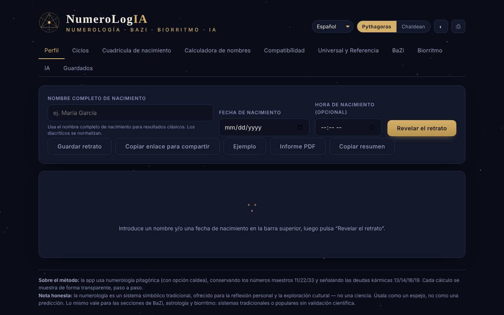

# NumeroLogIA

[English](README.md) · [Română](README.ro.md) · [Français](README.fr.md) · [Italiano](README.it.md) · **Español** · [Português](README.pt.md) · [Deutsch](README.de.md) · [Magyar](README.hu.md)

**Versión:** 1.2.3 · **Última actualización:** 2026-10-22

Idiomas de la interfaz: **Română, English, Français, Italiano, Español, Português (PT), Català, Deutsch, Magyar**

Numerología pitagórica y caldea, con análisis de ciclos, compatibilidad y un oráculo de IA opcional que funciona con tu modelo local.

**Aplicación en línea:** https://chiuta.github.io/NumeroLogIA/

## Qué es

NumeroLogIA calcula un «retrato» numerológico a partir del nombre completo de nacimiento, la fecha de nacimiento y, opcionalmente, la hora de nacimiento. La aplicación usa la numerología pitagórica (con opción caldea), conserva los números maestros 11/22/33 y señala las deudas kármicas 13/14/16/19; los cálculos se muestran paso a paso. La aplicación aclara explícitamente que la numerología es un sistema simbólico tradicional, ofrecido para la reflexión personal y la exploración cultural, no una ciencia.

## Funciones

- Interfaz en 9 idiomas: inglés, rumano, italiano, español, francés, portugués, catalán, alemán, húngaro.
- Conmutador de sistema **Pitágoras / Caldeo**; tema claro/oscuro (botón ◐); **⎙** para imprimir / guardar como PDF.
- Pestañas: **Perfil**, **Ciclos**, **Cuadrícula de nacimiento**, **Calculadora de nombres**, **Compatibilidad**, **Universal y Referencia**, **BaZi**, **Biorritmo**, **IA**, **Guardados**.
- Botones en Perfil: **Revelar el retrato**, **Guardar el retrato**, **Copiar enlace para compartir**, **Ejemplo**, **Informe PDF**.
- Calculadora de valor numérico para cualquier nombre o palabra, desglosada letra por letra (vocales y consonantes), en ambos sistemas, y comparación de dos nombres (nombres artísticos, nombres de casada, seudónimos).
- Compatibilidad entre dos personas (Camino de Vida, Expresión, Deseo del Alma).
- Los números universales del día y una referencia completa de los números.
- **Retratos guardados** en el navegador, con **exportación / importación JSON** (copia de seguridad; al importar se validan el nombre, la fecha y la hora, se eliminan los duplicados, máximo 50 entradas, archivo de menos de 1 MB).
- **Copiar el resumen** (Perfil): los números principales como texto simple, con la nota de que la numerología no tiene validación científica; una fecha introducida no válida produce ahora un mensaje.
- **Oráculo de IA** (opcional): síntesis del retrato, orientación para hoy, interpretación de compatibilidad y preguntas libres, enviadas a un modelo de lenguaje en una dirección que configuras tú (por defecto, Ollama local). Puede listar los modelos instalados y descargar modelos mediante Ollama.

## Guía de uso

1. Elige el idioma en la lista de idiomas y el sistema (Pitágoras o Caldeo).
2. En «Perfil», introduce el nombre completo de nacimiento (los signos diacríticos se normalizan), la fecha de nacimiento y, si quieres, la hora; pulsa **Revelar el retrato** (Enter en los campos hace lo mismo). **Ejemplo** rellena datos de demostración.
3. Recorre las pestañas Ciclos, Cuadrícula de nacimiento, BaZi y Biorritmo para el resto del análisis.
4. Para una palabra cualquiera usa «Calculadora de nombres»; para dos personas, «Compatibilidad».
5. **Guardar el retrato** lo conserva en la pestaña «Guardados»; **Copiar enlace para compartir** incluye en el enlace el nombre, la fecha, la hora, el idioma y el sistema.
6. **Informe PDF** o **⎙** abren el cuadro de impresión del navegador, desde donde puedes guardar un PDF.
7. Para la pestaña de IA: instala Ollama (u otro servidor compatible con OpenAI), inicia un modelo, abre «Ajustes», comprueba la dirección (por defecto `http://localhost:11434/v1`) y el modelo, pulsa guardar / probar y elige una acción. Si la página se sirve desde un sitio web, la aplicación indica iniciar Ollama con `OLLAMA_ORIGINS=*` para permitir la conexión desde el navegador.

## Advertencia

Contenido informativo/de entretenimiento, sin validación científica: la numerología, el BaZi, la astrología y el biorritmo son sistemas simbólicos tradicionales o populares, no ciencias, y no ofrecen predicciones ni consejos médicos, financieros o jurídicos. La aplicación muestra una «Nota honesta» en el pie de página; los textos generados por IA pueden ser erróneos o inventados.

## Privacidad y red

- **Almacenamiento local (localStorage):** `numerologie_saved_v1` (los retratos guardados), claves `num_pref_*` (idioma, sistema, tema) y `num_ai_*` (la dirección, el modelo y, si la introduces, la clave API del oráculo de IA: por defecto solo se conserva en `sessionStorage` (hasta cerrar la pestaña) y llega sin cifrar a `localStorage` únicamente si marcas «Recordar la clave entre sesiones»; la aplicación muestra ahora una advertencia visible bajo el campo «Clave API» de los Ajustes de IA, en los 7 idiomas).
- **Red:** los cálculos numerológicos no realizan peticiones. Las únicas peticiones posibles son las de la pestaña de IA, solo cuando pulsas una acción de IA (o el listado/descarga de modelos), hacia la dirección que hayas configurado, por defecto `http://localhost:11434` (Ollama en tu propio ordenador). Si configuras una dirección remota, tus nombres, datos y preguntas llegan a ese servidor. La aplicación no incluye claves, analítica ni telemetría y no carga recursos de terceros; una política CSP (`default-src 'none'`, `connect-src http: https:`) impide a la página cualquier otra carga.
- El enlace para compartir contiene, en la parte posterior a `#`, el nombre y la fecha introducidos (el hash se actualiza en cada cálculo, por lo que también aparece en la barra de direcciones/historial del navegador, pero no se envía a ningún servidor); el mensaje de confirmación de copia dice ahora explícitamente que el enlace contiene el nombre y la fecha de nacimiento; compártelo conscientemente.

## Ejecución local / offline

Descarga `index.html` y ábrelo en un navegador; la numerología funciona sin internet. El oráculo de IA necesita un servidor de modelos local (por ejemplo Ollama) o una dirección de tu elección.

## Historial / Changelog

### 1.2.3 — 2026-10-22
- Antes de que el oráculo IA envíe datos personales (fecha de nacimiento, nombre), se valida la dirección del modelo (solo http/https) y, para cualquier servidor que no esté en este dispositivo ni en la red local, se pide consentimiento explícito (recordado por host durante la sesión); confirmación de borrado en un diálogo propio; texto de las pistas a 12 px.

### 1.2.2 — 2026-10-22
- La nota de licencia/contacto del pie de página está traducida a todos los idiomas de la interfaz.

### 1.1.0 — 2026-10-14
- Copia de seguridad y etiquetado de datos (fff-kit).

### 12 de octubre de 2026 (v1.0.0)
- 1.0.0 — 2026-10-12: la versión y la fecha de la última actualización se muestran en la aplicación

### 11 de octubre de 2026 (segunda entrada)
- Seguridad: la clave API del oráculo de IA se conserva por defecto solo durante la sesión; el almacenamiento en `localStorage` es una opción explícita («Recordar la clave entre sesiones», 7 idiomas), y al guardar una clave antigua de `localStorage` se mueve a la sesión si la opción no está marcada. Probado en el navegador.

### 11 de octubre de 2026
- Accesibilidad: contenido envuelto en <main>, canvas decorativo oculto a los lectores de pantalla, etiquetas vinculadas a los campos (axe: 0 infracciones).
- Los datos de «hoy» (números universales, BaZi) se calculan dinámicamente a partir de la fecha actual; no hay fechas fijas obsoletas. Los atributos `on*` en línea (22) se sustituyeron por un despachador delegado (`data-click` / `data-change` / `data-input` / `data-keydown`, lista blanca de funciones, argumentos JSON) y la CSP usa un hash para el script, sin `'unsafe-inline'` para scripts (se mantiene para estilos; `connect-src http: https:` se mantiene para la dirección configurable del modelo de IA).
- Nuevo: exportación/importación JSON de los retratos guardados, «Copiar el resumen», mensaje para fecha no válida (en los 7 idiomas). Captura de pantalla actualizada.

## Licencia

MIT — véase el archivo `LICENSE`. © 2026 Alexandru-Ionuț Chiuță (Alexio). Las posibles bibliotecas de terceros incluidas en el archivo conservan sus propias licencias.

Licencia: MIT (véase el archivo LICENSE). Contacto: alexio@trom.tf

La misma declaración aparece en la cabecera HTML y en el pie de página de la aplicación (RO + EN). El texto de la licencia está en el archivo LICENSE.

## Auditoría

Auditoría: 2026-10-10 — verificado con Playwright y axe-core (todas las pestañas, ambos temas); verificado en el código: un solo `fetch` (pestaña de IA, bajo acción, hacia la dirección configurada); el nombre procedente del enlace `#n=` y de los campos, probado con ``, no se ejecuta (escapado). Corregidos: etiquetas ausentes en los campos de fecha/hora, contraste en el tema claro, nombre accesible del control deslizante del biorritmo.

## Autor

Alexio — Alexandru-Ionuț Chiuță. Contacto: alexio@trom.tf

## Resumen

NumeroLogIA es una herramienta de numerología en un solo archivo (sistemas pitagórico y caldeo, números maestros, ciclos, cuadrícula de nacimiento, calculadora de nombres, compatibilidad, BaZi, biorritmo) en 9 idiomas, con retratos guardados en localStorage. Una pestaña de IA opcional se comunica solo con un punto final que tú configuras (por defecto: Ollama local en localhost:11434); con un punto final remoto tus datos se enviarían allí. Sin telemetría ni recursos de terceros. Licencia: MIT (véase el archivo LICENSE) (contacto: alexio@trom.tf).

Ronda 3 (2026-10-11): añadida una declaración de licencia explícita (antes no declarada) (cabecera, pie de página, README); añadida la CSP; el tema esotérico y el almacenamiento de la clave API siguen siendo decisiones del autor.
