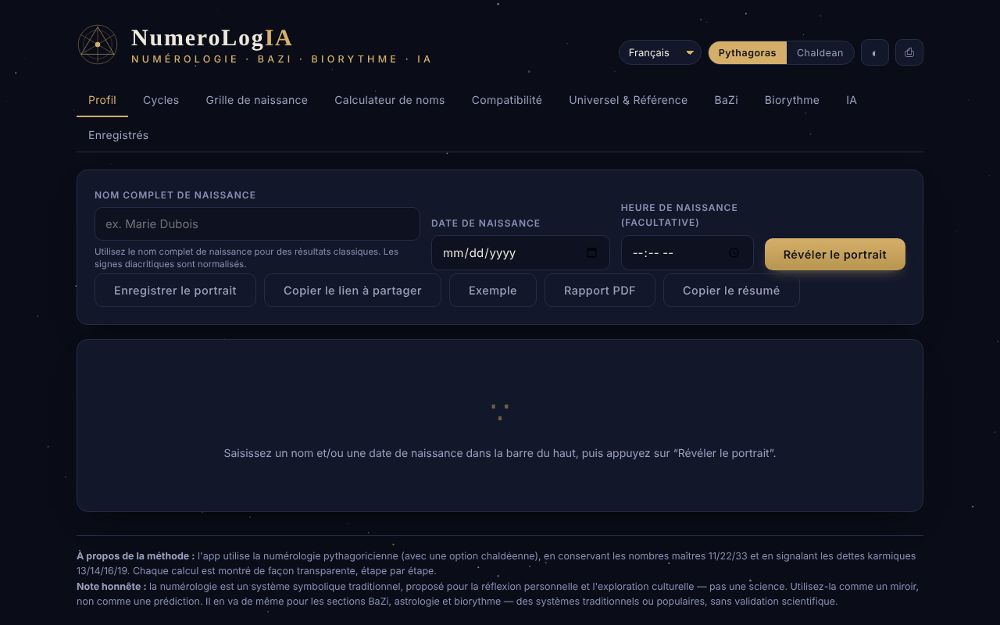

# NumeroLogIA

[English](README.md) · [Română](README.ro.md) · **Français** · [Italiano](README.it.md) · [Español](README.es.md) · [Português](README.pt.md) · [Deutsch](README.de.md) · [Magyar](README.hu.md)

**Version :** 1.2.4 · **Dernière mise à jour :** 2026-10-22

Langues de l'interface : **Română, English, Français, Italiano, Español, Português (PT), Català, Deutsch, Magyar**

Numérologie pythagoricienne et chaldéenne, avec analyse des cycles, compatibilité et un oracle IA facultatif qui fonctionne sur votre modèle local.

**Application en ligne :** https://chiuta.github.io/NumeroLogIA/

## Présentation

NumeroLogIA calcule un « portrait » numérologique à partir du nom complet de naissance, de la date de naissance et, en option, de l'heure de naissance. L'application utilise la numérologie pythagoricienne (avec une option chaldéenne), conserve les nombres maîtres 11/22/33 et signale les dettes karmiques 13/14/16/19 ; les calculs sont affichés étape par étape. L'application précise explicitement que la numérologie est un système symbolique traditionnel, proposé pour la réflexion personnelle et l'exploration culturelle, et non une science.

## Fonctionnalités

- Interface en 9 langues : anglais, roumain, italien, espagnol, français, portugais, catalan, allemand, hongrois.
- Commutateur de système **Pythagore / Chaldéen** ; thème clair/sombre (bouton ◐) ; **⎙** pour imprimer / enregistrer en PDF.
- Onglets : **Profil**, **Cycles**, **Grille de naissance**, **Calculateur de nom**, **Compatibilité**, **Universel et Référence**, **BaZi**, **Biorythme**, **IA**, **Enregistrés**.
- Boutons dans Profil : **Dévoiler le portrait**, **Enregistrer le portrait**, **Copier le lien partageable**, **Exemple**, **Rapport PDF**.
- Calculateur de valeur numérique pour n'importe quel nom ou mot, détaillé lettre par lettre (voyelles et consonnes), dans les deux systèmes, et comparaison de deux noms (noms de scène, noms de mariage, pseudonymes).
- Compatibilité entre deux personnes (Chemin de vie, Expression, Désir de l'âme).
- Les nombres universels du jour et une référence complète des nombres.
- **Portraits enregistrés** dans le navigateur, avec **export / import JSON** (sauvegarde ; à l'import, le nom, la date et l'heure sont validés, les doublons supprimés, 50 entrées au maximum, fichier de moins de 1 Mo).
- **Copier le résumé** (Profil) : les nombres principaux en texte brut, avec la mention que la numérologie n'a aucune validation scientifique ; une date saisie invalide produit désormais un message.
- **Oracle IA** (facultatif) : synthèse de portrait, guidance pour aujourd'hui, interprétation de compatibilité et questions libres, envoyées à un modèle de langage à une adresse que vous définissez vous-même (par défaut Ollama en local). Il peut lister les modèles installés et télécharger des modèles via Ollama.

## Mode d'emploi

1. Choisissez la langue dans la liste des langues et le système (Pythagore ou Chaldéen).
2. Dans « Profil », saisissez le nom complet de naissance (les signes diacritiques sont normalisés), la date de naissance et, si vous le souhaitez, l'heure ; appuyez sur **Dévoiler le portrait** (Entrée dans les champs fait la même chose). **Exemple** remplit des données de démonstration.
3. Parcourez les onglets Cycles, Grille de naissance, BaZi et Biorythme pour le reste de l'analyse.
4. Pour un mot quelconque, utilisez « Calculateur de nom » ; pour deux personnes, « Compatibilité ».
5. **Enregistrer le portrait** le conserve dans l'onglet « Enregistrés » ; **Copier le lien partageable** place dans le lien le nom, la date, l'heure, la langue et le système.
6. **Rapport PDF** ou **⎙** ouvrent la boîte de dialogue d'impression du navigateur, d'où vous pouvez enregistrer un PDF.
7. Pour l'onglet IA : installez Ollama (ou un autre serveur compatible OpenAI), lancez un modèle, ouvrez « Paramètres », vérifiez l'adresse (par défaut `http://localhost:11434/v1`) et le modèle, appuyez sur enregistrer / tester, puis choisissez une action. Si la page est servie depuis un site, l'application indique de démarrer Ollama avec `OLLAMA_ORIGINS=*` pour autoriser la connexion depuis le navigateur.

## Avertissement

Contenu informatif/de divertissement, sans validation scientifique : la numérologie, le BaZi, l'astrologie et le biorythme sont des systèmes symboliques traditionnels ou populaires, non des sciences, et n'offrent ni prédictions ni conseils médicaux, financiers ou juridiques. L'application affiche une « Note honnête » en pied de page ; les textes générés par l'IA peuvent être faux ou inventés.

## Confidentialité et réseau

- **Stockage local (localStorage) :** `numerologie_saved_v1` (les portraits enregistrés), clés `num_pref_*` (langue, système, thème) et `num_ai_*` (l'adresse, le modèle et, si vous la saisissez, la clé API de l'oracle IA : par défaut elle n'est conservée que dans `sessionStorage` (jusqu'à la fermeture de l'onglet) et n'arrive non chiffrée dans `localStorage` que si vous cochez « Mémoriser la clé entre les sessions » ; l'application affiche désormais un avertissement visible sous le champ « Clé API » des Paramètres IA, dans les 7 langues).
- **Réseau :** les calculs numérologiques n'effectuent aucune requête. Les seules requêtes possibles sont celles de l'onglet IA, uniquement lorsque vous appuyez sur une action IA (ou sur la liste/le téléchargement de modèles), vers l'adresse que vous avez configurée, par défaut `http://localhost:11434` (Ollama sur votre propre ordinateur). Si vous définissez une adresse distante, vos noms, données et questions parviennent à ce serveur. L'application n'inclut ni clés, ni analytique, ni télémétrie et ne charge aucune ressource tierce ; une politique CSP (`default-src 'none'`, `connect-src http: https:`) interdit à la page tout autre chargement.
- Le lien partageable contient, dans la partie après `#`, le nom et la date saisis (le hash est mis à jour à chaque calcul, il apparaît donc aussi dans la barre d'adresse/l'historique du navigateur, mais n'est envoyé à aucun serveur) ; le message de confirmation de copie indique désormais explicitement que le lien contient le nom et la date de naissance ; partagez-le en connaissance de cause.

## Exécution locale / hors ligne

Téléchargez `index.html` et ouvrez-le dans un navigateur ; la numérologie fonctionne sans internet. L'oracle IA a besoin d'un serveur de modèles local (par exemple Ollama) ou d'une adresse de votre choix.

## Historique / Changelog

### 1.2.4 — 2026-10-22
- fff-kit 1.1.2 : PBKDF2 à 600 000 itérations, protection anti-clickjacking

### 1.2.3 — 2026-10-22
- Avant que l'oracle IA n'envoie des données personnelles (date de naissance, nom), l'adresse du modèle est validée (http/https uniquement) et, pour tout serveur qui n'est ni sur cet appareil ni sur le réseau local, un consentement explicite est demandé (mémorisé par hôte pour la session); confirmation de suppression dans une boîte de dialogue propre; texte des indications à 12 px.

### 1.2.2 — 2026-10-22
- La note de licence/contact du pied de page est traduite dans toutes les langues de l'interface.

### 1.1.0 — 2026-10-14
- Sauvegarde et étiquetage des données (fff-kit).

### 12 octobre 2026 (v1.0.0)
- 1.0.0 — 2026-10-12 : la version et la date de dernière mise à jour sont affichées dans l'application

### 11 octobre 2026 (deuxième entrée)
- Sécurité : la clé API de l'oracle IA n'est conservée par défaut que pour la session ; le stockage dans `localStorage` est une option explicite (« Mémoriser la clé entre les sessions », 7 langues), et à l'enregistrement une ancienne clé de `localStorage` est déplacée vers la session si l'option n'est pas cochée. Testé dans le navigateur.

### 11 octobre 2026
- Accessibilité : contenu encadré par <main>, canevas décoratif masqué aux lecteurs d'écran, étiquettes liées aux champs (axe : 0 violation).
- Les données « aujourd'hui » (nombres universels, BaZi) sont calculées dynamiquement à partir de la date courante ; il n'y a pas de dates fixes périmées. Les attributs `on*` en ligne (22) ont été remplacés par un répartiteur délégué (`data-click` / `data-change` / `data-input` / `data-keydown`, liste blanche de fonctions, arguments JSON) et la CSP utilise un hachage pour le script, sans `'unsafe-inline'` pour les scripts (il reste pour les styles ; `connect-src http: https:` reste pour l'adresse configurable du modèle IA).
- Nouveau : export/import JSON des portraits enregistrés, « Copier le résumé », message pour date invalide (dans les 7 langues). Capture d'écran mise à jour.

## Licence

MIT — voir le fichier `LICENSE`. © 2026 Alexandru-Ionuț Chiuță (Alexio). Les éventuelles bibliothèques tierces incluses dans le fichier conservent leurs propres licences.

Licence : MIT (voir le fichier LICENSE). Contact : alexio@trom.tf

La même déclaration figure dans l'en-tête HTML et dans le pied de page de l'application (RO + EN). Le texte de la licence se trouve dans le fichier LICENSE.

## Audit

Audit : 2026-10-10 — vérifié avec Playwright et axe-core (tous les onglets, les deux thèmes) ; vérifié dans le code : un seul `fetch` (onglet IA, sur action, vers l'adresse configurée) ; le nom provenant du lien `#n=` et des champs, testé avec ``, ne s'exécute pas (échappé). Corrigés : étiquettes manquantes sur les champs de date/heure, contraste du thème clair, nom accessible du curseur de biorythme.

## Auteur

Alexio — Alexandru-Ionuț Chiuță. Contact : alexio@trom.tf

## Résumé
NumeroLogIA est un outil de numérologie en un seul fichier (systèmes pythagoricien et chaldéen, nombres maîtres, cycles, grille de naissance, calculateur de nom, compatibilité, BaZi, biorythme) en 9 langues, avec des portraits enregistrés dans localStorage. Un onglet IA facultatif ne communique qu'avec un point de terminaison que vous configurez (par défaut : Ollama local sur localhost:11434) ; avec un point de terminaison distant, vos saisies y seraient envoyées. Aucune télémétrie ni ressource tierce. Licence : MIT (voir le fichier LICENSE) (contact : alexio@trom.tf).

Tour 3 (2026-10-11) : déclaration de licence explicite (auparavant non déclarée) ajoutée (en-tête, pied de page, README) ; CSP ajoutée ; le thème ésotérique et le stockage de la clé API restent des décisions de l'auteur.
