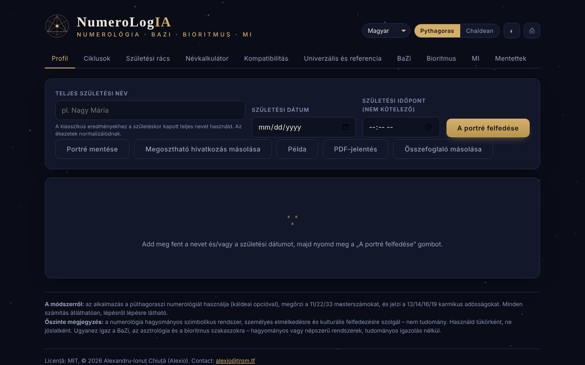

# NumeroLogIA

[English](README.md) · [Română](README.ro.md) · [Français](README.fr.md) · [Italiano](README.it.md) · [Español](README.es.md) · [Português](README.pt.md) · [Deutsch](README.de.md) · **Magyar**

**Verzió:** 1.2.6 · **Utolsó frissítés:** 2026-10-23

A felület nyelvei: **Română, English, Français, Italiano, Español, Português (PT), Català, Deutsch, Magyar**

Püthagoraszi és káldeai numerológia cikluselemzéssel, kompatibilitással és egy opcionális MI-orákulummal, amely a saját helyi modelleden fut.

**Online alkalmazás:** https://chiuta.github.io/NumeroLogIA/

## Mi ez

A NumeroLogIA numerológiai „portrét” számít a teljes születési névből, a születési dátumból és opcionálisan a születési időből. Az alkalmazás a püthagoraszi numerológiát használja (káldeai opcióval), megőrzi a 11/22/33 mestereket, és jelzi a 13/14/16/19 karmikus adósságokat; a számítások lépésről lépésre láthatók. Az alkalmazás kifejezetten leszögezi, hogy a numerológia hagyományos szimbolikus rendszer, amelyet személyes elmélkedésre és kulturális felfedezésre kínál, nem tudomány.

## Funkciók

- Felület 9 nyelven: angol, román, olasz, spanyol, francia, portugál, katalán, német, magyar.
- **Püthagorasz / Káldeai** rendszerváltó; világos/sötét téma (◐ gomb); **⎙** nyomtatáshoz / PDF-mentéshez.
- Lapok: **Profil**, **Ciklusok**, **Születési rács**, **Névszámító**, **Kompatibilitás**, **Univerzális és Referencia**, **BaZi**, **Bioritmus**, **MI**, **Mentettek**.
- Gombok a Profilban: **A portré feltárása**, **A portré mentése**, **Megosztható hivatkozás másolása**, **Példa**, **PDF-jelentés**.
- Számérték-számító bármely névhez vagy szóhoz, betűnként lebontva (magánhangzók és mássalhangzók), mindkét rendszerben, valamint két név összehasonlítása (művésznevek, házassági nevek, álnevek).
- Kompatibilitás két személy között (Életút, Kifejezés, Lélekvágy).
- A nap univerzális számai és a számok teljes referenciája.
- **Mentett portrék** a böngészőben, **JSON-exporttal / -importtal** (biztonsági mentés; importáláskor a név, a dátum és az idő érvényesítésre kerül, a duplikátumok törlődnek, legfeljebb 50 bejegyzés, 1 MB alatti fájl).
- **Összegzés másolása** (Profil): a fő számok egyszerű szövegként, azzal a megjegyzéssel, hogy a numerológiának nincs tudományos érvényesítése; egy érvénytelenül megadott dátum mostantól üzenetet eredményez.
- **MI-orákulum** (opcionális): portréösszegzés, útmutatás mára, kompatibilitás-értelmezés és szabad kérdések, amelyeket egy nyelvi modellnek küld egy általad megadott címen (alapértelmezés: helyi Ollama). Listázhatja a telepített modelleket, és modelleket tölthet le az Ollamán keresztül.

## Használati útmutató

1. Válaszd ki a nyelvet a nyelvlistából és a rendszert (Püthagorasz vagy Káldeai).
2. A „Profil”-ban add meg a teljes születési nevet (az ékezetes jelek normalizálódnak), a születési dátumot és, ha szeretnéd, az időt; nyomd meg **A portré feltárása** gombot (az Enter a mezőkben ugyanezt teszi). A **Példa** bemutató adatokat tölt ki.
3. A további elemzéshez lapozd végig a Ciklusok, Születési rács, BaZi és Bioritmus lapokat.
4. Bármely szóhoz használd a „Névszámító”-t; két személyhez a „Kompatibilitás”-t.
5. **A portré mentése** a „Mentettek” lapon őrzi meg; a **Megosztható hivatkozás másolása** a hivatkozásba teszi a nevet, a dátumot, az időt, a nyelvet és a rendszert.
6. A **PDF-jelentés** vagy a **⎙** megnyitja a böngésző nyomtatási párbeszédablakát, ahonnan PDF-ként menthetsz.
7. Az MI laphoz: telepítsd az Ollamát (vagy más, OpenAI-kompatibilis szervert), indíts el egy modellt, nyisd meg a „Beállítások”-at, ellenőrizd a címet (alapértelmezés: `http://localhost:11434/v1`) és a modellt, nyomd meg a mentés / teszt gombot, majd válassz egy műveletet. Ha az oldalt egy weboldalról szolgálják ki, az alkalmazás jelzi, hogy az Ollamát az `OLLAMA_ORIGINS=*` beállítással indítsd, hogy a böngészőből is engedélyezze a kapcsolatot.

## Figyelmeztetés

Tájékoztató/szórakoztató tartalom, tudományos érvényesítés nélkül: a numerológia, a BaZi, az asztrológia és a bioritmus hagyományos vagy népszerű szimbolikus rendszerek, nem tudományok, és nem nyújtanak jóslatot, sem orvosi, pénzügyi vagy jogi tanácsot. Az alkalmazás a láblécben „Őszinte megjegyzést” jelenít meg; az MI által generált szövegek tévesek vagy kitaláltak lehetnek.

## Adatvédelem és hálózat

- **Helyi tárolás (localStorage):** `numerologie_saved_v1` (a mentett portrék), `num_pref_*` kulcsok (nyelv, rendszer, téma) és `num_ai_*` (a cím, a modell és, ha megadod, az MI-orákulum API-kulcsa: alapértelmezés szerint csak a `sessionStorage`-ban marad (a lap bezárásáig), és csak akkor kerül titkosítatlanul a `localStorage`-ba, ha bejelölöd a „Kulcs megjegyzése munkamenetek között” opciót; az alkalmazás mostantól jól látható figyelmeztetést jelenít meg az MI-beállítások „API-kulcs” mezője alatt, mind a 7 nyelven).
- **Hálózat:** a numerológiai számítások nem küldenek kéréseket. Az egyetlen lehetséges kérések az MI lapról származnak, csak amikor MI-műveletet (vagy modelllistázást/-letöltést) indítasz, az általad beállított címre, alapértelmezés szerint `http://localhost:11434` (Ollama a saját számítógépeden). Ha távoli címet adsz meg, a neveid, adataid és kérdéseid arra a szerverre jutnak. Az alkalmazás nem tartalmaz kulcsokat, analitikát vagy telemetriát, és nem tölt be harmadik fél erőforrásait; egy CSP-szabályzat (`default-src 'none'`, `connect-src http: https:`) minden egyéb betöltést megtilt az oldalnak.
- A megosztható hivatkozás a `#` utáni részben tartalmazza a megadott nevet és dátumot (a hash minden számításkor frissül, így megjelenik a címsorban/böngészőelőzményekben is, de nem kerül elküldésre egyetlen szervernek sem); a másolás visszaigazoló üzenete mostantól kifejezetten közli, hogy a hivatkozás a nevet és a születési dátumot tartalmazza; tudatosan oszd meg.

## Helyi futtatás / offline

Töltsd le az `index.html` fájlt, és nyisd meg böngészőben; a numerológia internet nélkül is működik. Az MI-orákulumhoz helyi modellszerver (például Ollama) vagy az általad választott cím szükséges.

## Előzmények / Changelog

### 1.2.5 — 2026-10-22

fff-kit 1.1.4: érintési célok és minimális szövegméret.

### 1.2.4 — 2026-10-22
- fff-kit 1.1.2: PBKDF2 600 000 iterációval, clickjacking elleni védelem

### 1.2.3 — 2026-10-22
- Mielőtt az MI-orákulum személyes adatokat (születési dátum, név) küldene, a modell címe ellenőrzésre kerül (csak http/https), és minden olyan szerverhez, amely nincs ezen az eszközön vagy a helyi hálózaton, kifejezett hozzájárulást kér (hostonként, a munkamenet idejére megjegyezve); a törlés megerősítése saját párbeszédablakban; a súgószöveg 12 px.

### 1.2.2 — 2026-10-22
- A láblécben lévő licenc-/kapcsolati megjegyzés az összes felületi nyelvre le van fordítva.

### 1.1.0 — 2026-10-14
- Adatmentés és adatcímkézés (fff-kit).

### 2026. október 12. (v1.0.0)
- 1.0.0 — 2026-10-12: a verzió és az utolsó frissítés dátuma megjelenik az alkalmazásban

### 2026. október 11. (második bejegyzés)
- Biztonság: az MI-orákulum API-kulcsát alapértelmezés szerint csak a munkamenet idejére őrzi meg; a `localStorage`-ban való tárolás kifejezett opció („Kulcs megjegyzése munkamenetek között”, 7 nyelv), és mentéskor egy régi `localStorage`-beli kulcs a munkamenetbe kerül át, ha az opció nincs bejelölve. Böngészőben tesztelve.

### 2026. október 11.
- Hozzáférhetőség: a tartalom <main> elembe foglalva, a dekoratív canvas elrejtve a képernyőolvasók elől, a címkék a mezőkhöz kötve (axe: 0 szabálysértés).
- A „mai” adatok (univerzális számok, BaZi) dinamikusan, az aktuális dátumból számolódnak; nincsenek elavult rögzített dátumok. A beágyazott `on*` attribútumokat (22) delegált diszpécser váltotta fel (`data-click` / `data-change` / `data-input` / `data-keydown`, függvények engedélyezőlistája, JSON-argumentumok), és a CSP a szkripthez hash-t használ, a szkriptekhez `'unsafe-inline'` nélkül (a stílusoknál marad; a `connect-src http: https:` az MI-modell beállítható címe miatt marad).
- Új: a mentett portrék JSON-exportja/-importja, „Összegzés másolása”, üzenet érvénytelen dátumhoz (a 7 nyelven). Képernyőkép frissítve.

## Licenc

MIT — lásd a `LICENSE` fájlt. © 2026 Alexandru-Ionuț Chiuță (Alexio). A fájlban esetleg szereplő harmadik fél által készített könyvtárak megtartják saját licencüket.

Licenc: MIT (lásd a LICENSE fájlt). Kapcsolat: alexio@trom.tf

Ugyanez a nyilatkozat megjelenik a HTML-fejlécben és az alkalmazás láblécében (RO + EN). A licenc szövege a LICENSE fájlban található.

## Audit

Audit: 2026-10-10 — Playwright-tal és axe-core-ral ellenőrizve (minden lap, mindkét téma); a kódban ellenőrizve: egyetlen `fetch` (MI lap, művelet hatására, a beállított címre); a `#n=` hivatkozásból és a mezőkből származó név, ``-ral tesztelve, nem hajtódik végre (escape-elt). Javítva: hiányzó címkék a dátum-/időmezőkön, kontraszt a világos témában, elérhető név a bioritmus-csúszkán.

## Szerző

Alexio — Alexandru-Ionuț Chiuță. Kapcsolat: alexio@trom.tf

## Összefoglaló
A NumeroLogIA egyfájlos numerológiai eszköz (püthagoraszi és káldeai rendszer, mesterszámok, ciklusok, születési rács, névszámító, kompatibilitás, BaZi, bioritmus) 9 nyelven, a mentett portrékat a localStorage-ban őrzi. Az opcionális MI-lap csak az általad beállított végponttal kommunikál (alapértelmezés: helyi Ollama a localhost:11434 címen); távoli végpont esetén a megadott adataid oda kerülnének. Nincs telemetria és harmadik fél erőforrása. Licenc: MIT (lásd a LICENSE fájlt) (kapcsolat: alexio@trom.tf).

3. kör (2026-10-11): kifejezett licencnyilatkozat (korábban nem volt deklarálva) hozzáadva (fejléc, lábléc, README); CSP hozzáadva; az ezoterikus téma és az API-kulcs tárolása a szerző döntése marad.
