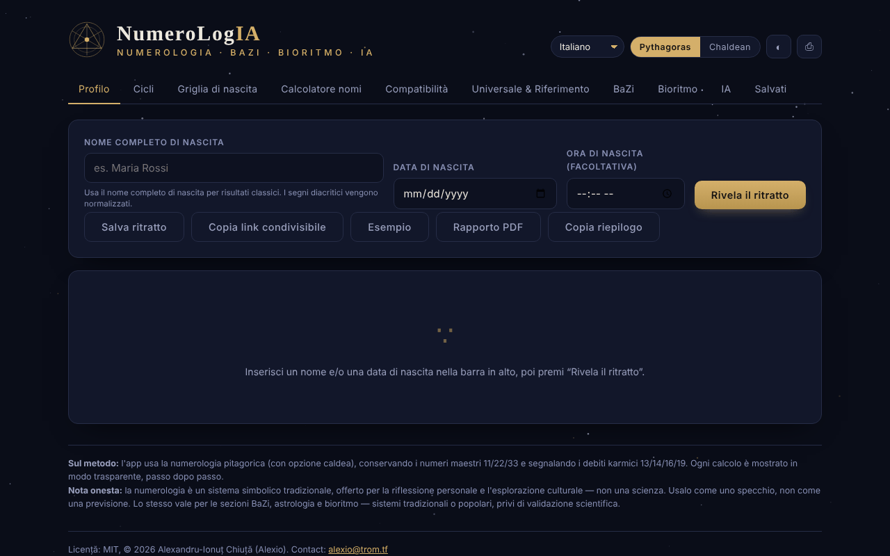

# NumeroLogIA

[English](README.md) · [Română](README.ro.md) · [Français](README.fr.md) · **Italiano** · [Español](README.es.md) · [Português](README.pt.md) · [Deutsch](README.de.md) · [Magyar](README.hu.md)

**Versione:** 1.2.9 · **Ultimo aggiornamento:** 2026-10-26

Lingue dell'interfaccia: **Română, English, Français, Italiano, Español, Português (PT), Català, Deutsch, Magyar**

Numerologia pitagorica e caldea, con analisi dei cicli, compatibilità e un oracolo IA facoltativo che funziona sul tuo modello locale.

**App online:** https://chiuta.github.io/NumeroLogIA/

## Che cos'è

NumeroLogIA calcola un «ritratto» numerologico a partire dal nome completo alla nascita, dalla data di nascita e, facoltativamente, dall'ora di nascita. L'applicazione usa la numerologia pitagorica (con opzione caldea), conserva i numeri maestri 11/22/33 e segnala i debiti karmici 13/14/16/19; i calcoli sono mostrati passo per passo. L'applicazione precisa esplicitamente che la numerologia è un sistema simbolico tradizionale, offerto per la riflessione personale e l'esplorazione culturale, non una scienza.

## Funzionalità

- Interfaccia in 9 lingue: inglese, rumeno, italiano, spagnolo, francese, portoghese, catalano, tedesco, ungherese.
- Selettore di sistema **Pitagora / Caldeo**; tema chiaro/scuro (pulsante ◐); **⎙** per stampare / salvare in PDF.
- Schede: **Profilo**, **Cicli**, **Griglia di nascita**, **Calcolatore di nomi**, **Compatibilità**, **Universale e Riferimento**, **BaZi**, **Bioritmo**, **IA**, **Salvati**.
- Pulsanti nel Profilo: **Svela il ritratto**, **Salva il ritratto**, **Copia link condivisibile**, **Esempio**, **Rapporto PDF**.
- Calcolatore del valore numerico per qualsiasi nome o parola, scomposto lettera per lettera (vocali e consonanti), nei due sistemi, e confronto tra due nomi (nomi d'arte, nomi da sposata, pseudonimi).
- Compatibilità tra due persone (Cammino di Vita, Espressione, Desiderio dell'Anima).
- I numeri universali del giorno e un riferimento completo dei numeri.
- **Ritratti salvati** nel browser, con **esportazione / importazione JSON** (backup; all'importazione si convalidano nome, data e ora, si eliminano i duplicati, massimo 50 voci, file sotto 1 MB).
- **Copia il riepilogo** (Profilo): i numeri principali come testo semplice, con la nota che la numerologia non ha validazione scientifica; una data inserita non valida produce ora un messaggio.
- **Oracolo IA** (facoltativo): sintesi del ritratto, guida per oggi, interpretazione della compatibilità e domande libere, inviate a un modello linguistico a un indirizzo che imposti tu (predefinito: Ollama locale). Può elencare i modelli installati e scaricare modelli tramite Ollama.

## Guida all'uso

1. Scegli la lingua dall'elenco delle lingue e il sistema (Pitagora o Caldeo).
2. In «Profilo», inserisci il nome completo alla nascita (i segni diacritici vengono normalizzati), la data di nascita e, se vuoi, l'ora; premi **Svela il ritratto** (Invio nei campi fa la stessa cosa). **Esempio** compila dati dimostrativi.
3. Percorri le schede Cicli, Griglia di nascita, BaZi e Bioritmo per il resto dell'analisi.
4. Per una parola qualsiasi usa «Calcolatore di nomi»; per due persone, «Compatibilità».
5. **Salva il ritratto** lo conserva nella scheda «Salvati»; **Copia link condivisibile** inserisce nel link nome, data, ora, lingua e sistema.
6. **Rapporto PDF** o **⎙** aprono la finestra di stampa del browser, da cui puoi salvare un PDF.
7. Per la scheda IA: installa Ollama (o un altro server compatibile con OpenAI), avvia un modello, apri «Impostazioni», verifica l'indirizzo (predefinito `http://localhost:11434/v1`) e il modello, premi salva / prova, poi scegli un'azione. Se la pagina è servita da un sito, l'applicazione indica di avviare Ollama con `OLLAMA_ORIGINS=*` per consentire la connessione dal browser.

## Avvertenza

Contenuto informativo/di intrattenimento, privo di validazione scientifica: la numerologia, il BaZi, l'astrologia e il bioritmo sono sistemi simbolici tradizionali o popolari, non scienze, e non offrono previsioni né consigli medici, finanziari o legali. L'applicazione mostra una «Nota onesta» a piè di pagina; i testi generati dall'IA possono essere errati o inventati.

## Privacy e rete

- **Archiviazione locale (localStorage):** `numerologia.saved_v1` (i ritratti salvati), chiavi `numerologia.pref.*` (lingua, sistema, tema) e `numerologia.ai.*` (l'indirizzo, il modello e, se la inserisci, la chiave API dell'oracolo IA: per impostazione predefinita viene conservata solo in `sessionStorage` (fino alla chiusura della scheda) e arriva non cifrata in `localStorage` solo se spunti «Ricorda la chiave tra le sessioni»; l'applicazione mostra ora un avviso ben visibile sotto il campo «Chiave API» nelle Impostazioni IA, in tutte e 7 le lingue).
- **Rete:** i calcoli numerologici non effettuano richieste. Le uniche richieste possibili sono quelle della scheda IA, solo quando premi un'azione IA (o l'elenco/scaricamento di modelli), verso l'indirizzo da te configurato, per impostazione predefinita `http://localhost:11434` (Ollama sul tuo computer). Se imposti un indirizzo remoto, i tuoi nomi, dati e domande arrivano a quel server. L'applicazione non include chiavi, analytics né telemetria e non carica risorse di terze parti; una policy CSP (`default-src 'none'`, `connect-src http: https:`) impedisce alla pagina qualsiasi altro caricamento.
- Il link condivisibile contiene, nella parte dopo `#`, il nome e la data inseriti (l'hash viene aggiornato a ogni calcolo, quindi compare anche nella barra degli indirizzi/cronologia del browser, ma non viene inviato a nessun server); il messaggio di conferma della copia dice ora esplicitamente che il link contiene il nome e la data di nascita; condividilo consapevolmente.

## Esecuzione locale / offline

Scarica `index.html` e aprilo in un browser; la numerologia funziona senza internet. L'oracolo IA richiede un server di modelli locale (per esempio Ollama) o un indirizzo a tua scelta.

## Cronologia / Changelog

### 1.2.7 — 2026-10-23

- Archiviazione: le chiavi ora hanno il prefisso dell'app (`numerologia.saved_v1`, `numerologia.pref.*`, `numerologia.ai.*`); i dati esistenti vengono migrati automaticamente all'avvio dalle vecchie chiavi (`numerologie_saved_v1`, `num_pref_*`, `num_ai_*`) e i vecchi backup `.fff.json` si importano ancora (fff-kit 1.2.0).

### 1.2.5 — 2026-10-22

fff-kit 1.1.4: target touch e dimensione minima del testo.

### 1.2.4 — 2026-10-22
- fff-kit 1.1.2: PBKDF2 con 600.000 iterazioni, protezione anti-clickjacking

### 1.2.3 — 2026-10-22
- Prima che l'oracolo IA invii dati personali (data di nascita, nome), l'indirizzo del modello viene validato (solo http/https) e, per qualsiasi server che non sia su questo dispositivo o sulla rete locale, viene richiesto un consenso esplicito (ricordato per host durante la sessione); conferma di eliminazione in una finestra di dialogo propria; testo dei suggerimenti a 12 px.

### 1.2.2 — 2026-10-22
- La nota su licenza/contatto nel piè di pagina è tradotta in tutte le lingue dell'interfaccia.

### 1.1.0 — 2026-10-14
- Backup ed etichettatura dei dati (fff-kit).

### 12 ottobre 2026 (v1.0.0)
- 1.0.0 — 2026-10-12: la versione e la data dell'ultimo aggiornamento sono mostrate nell'app

### 11 ottobre 2026 (seconda voce)
- Sicurezza: la chiave API dell'oracolo IA viene conservata per impostazione predefinita solo per la sessione; l'archiviazione in `localStorage` è un'opzione esplicita («Ricorda la chiave tra le sessioni», 7 lingue), e al salvataggio una vecchia chiave in `localStorage` viene spostata nella sessione se l'opzione non è spuntata. Testato nel browser.

### 11 ottobre 2026
- Accessibilità: contenuto racchiuso in <main>, canvas decorativo nascosto ai lettori di schermo, etichette collegate ai campi (axe: 0 violazioni).
- I dati «oggi» (numeri universali, BaZi) sono calcolati dinamicamente dalla data corrente; non esistono date fisse obsolete. Gli attributi `on*` inline (22) sono stati sostituiti da un dispatcher delegato (`data-click` / `data-change` / `data-input` / `data-keydown`, lista bianca di funzioni, argomenti JSON) e la CSP usa un hash per lo script, senza `'unsafe-inline'` per gli script (resta per gli stili; `connect-src http: https:` resta per l'indirizzo configurabile del modello IA).
- Novità: esportazione/importazione JSON dei ritratti salvati, «Copia il riepilogo», messaggio per data non valida (nelle 7 lingue). Schermata aggiornata.

## Licenza

MIT — vedi il file `LICENSE`. © 2026 Alexandru-Ionuț Chiuță (Alexio). Le eventuali librerie di terze parti incluse nel file mantengono le proprie licenze.

Licenza: MIT (vedi il file LICENSE). Contatto: alexio@trom.tf

La stessa dichiarazione compare nell'intestazione HTML e nel piè di pagina dell'applicazione (RO + EN). Il testo della licenza si trova nel file LICENSE.

## Audit

Audit: 2026-10-10 — verificato con Playwright e axe-core (tutte le schede, entrambi i temi); verificato nel codice: un solo `fetch` (scheda IA, su azione, verso l'indirizzo configurato); il nome proveniente dal link `#n=` e dai campi, testato con ``, non viene eseguito (escape). Corretti: etichette mancanti nei campi data/ora, contrasto nel tema chiaro, nome accessibile del cursore del bioritmo.

## Autore

Alexio — Alexandru-Ionuț Chiuță. Contatto: alexio@trom.tf

## Riepilogo
NumeroLogIA è uno strumento di numerologia a file singolo (sistemi pitagorico e caldeo, numeri maestri, cicli, griglia di nascita, calcolatore di nomi, compatibilità, BaZi, bioritmo) in 9 lingue, con ritratti salvati in localStorage. Una scheda IA facoltativa comunica solo con un endpoint da te configurato (predefinito: Ollama locale su localhost:11434); con un endpoint remoto i tuoi dati verrebbero inviati lì. Nessuna telemetria né risorse di terze parti. Licenza: MIT (vedi il file LICENSE) (contatto: alexio@trom.tf).

Turno 3 (2026-10-11): aggiunta una dichiarazione di licenza esplicita (prima non dichiarata) (intestazione, piè di pagina, README); aggiunta la CSP; il tema esoterico e la memorizzazione della chiave API restano decisioni dell'autore.
