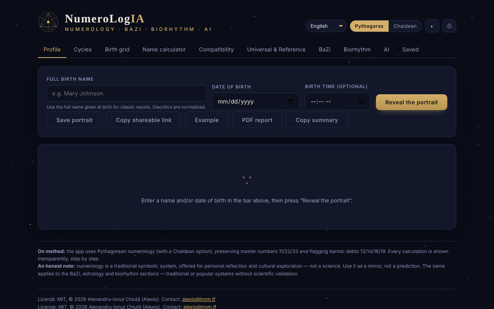

# NumeroLogIA

**English** · [Română](README.ro.md) · [Français](README.fr.md) · [Italiano](README.it.md) · [Español](README.es.md) · [Português](README.pt.md) · [Deutsch](README.de.md) · [Magyar](README.hu.md)

**Version:** 1.2.3 · **Last updated:** 2026-10-22

Interface languages: **Română, English, Français, Italiano, Español, Português (PT), Català, Deutsch, Magyar**

Pythagorean and Chaldean numerology, with cycle analysis, compatibility and an optional AI oracle that runs on your own local model.

**Live app:** https://chiuta.github.io/NumeroLogIA/

## What it is

NumeroLogIA calculates a numerological "portrait" from the full birth name, the date of birth and, optionally, the time of birth. The application uses Pythagorean numerology (with a Chaldean option), keeps the master numbers 11/22/33 and flags the karmic debts 13/14/16/19; the calculations are shown step by step. The application states explicitly that numerology is a traditional symbolic system, offered for personal reflection and cultural exploration, not a science.

## Features

- Interface in 9 languages: English, Romanian, Italian, Spanish, French, Portuguese, Catalan, German, Hungarian.
- **Pythagoras / Chaldean** system switch; light/dark theme (the ◐ button); **⎙** for printing / saving as PDF.
- Tabs: **Profile**, **Cycles**, **Birth grid**, **Name calculator**, **Compatibility**, **Universal & Reference**, **BaZi**, **Biorhythm**, **AI**, **Saved**.
- Buttons in Profile: **Reveal the portrait**, **Save the portrait**, **Copy shareable link**, **Example**, **PDF report**.
- Numeric-value calculator for any name or word, broken down letter by letter (vowels and consonants), in both systems, and comparison of two names (stage names, married names, pseudonyms).
- Compatibility between two people (Life Path, Expression, Soul Urge).
- The universal numbers of the day and a complete reference of the numbers.
- **Saved portraits** in the browser, with **JSON export / import** (backup; on import the name, date and time are validated, duplicates are removed, maximum 50 entries, file under 1 MB).
- **Copy the summary** (Profile): the main numbers as plain text, with the note that numerology has no scientific validation; an invalid date entered now produces a message.
- **AI oracle** (optional): portrait synthesis, guidance for today, compatibility interpretation and free-form questions, sent to a language model at an address that you set yourself (default: local Ollama). It can list installed models and download models via Ollama.

## User guide

1. Choose the language from the language list and the system (Pythagoras or Chaldean).
2. In "Profile", enter the full birth name (diacritics are normalized), the date of birth and, if you wish, the time; press **Reveal the portrait** (Enter in the fields does the same). **Example** fills in demonstration data.
3. Go through the Cycles, Birth grid, BaZi and Biorhythm tabs for the rest of the analysis.
4. For any word, use "Name calculator"; for two people, "Compatibility".
5. **Save the portrait** keeps it in the "Saved" tab; **Copy shareable link** puts the name, date, time, language and system in the link.
6. **PDF report** or **⎙** open the browser's print dialog, from which you can save a PDF.
7. For the AI tab: install Ollama (or another OpenAI-compatible server), start a model, open "Settings", check the address (default `http://localhost:11434/v1`) and the model, press save / test, then choose an action. If the page is served from a website, the application tells you to start Ollama with `OLLAMA_ORIGINS=*` to allow the connection from the browser.

## Disclaimer

Informational/entertainment content, without scientific validation: numerology, BaZi, astrology and biorhythm are traditional or popular symbolic systems, not sciences, and offer no predictions or medical, financial or legal advice. The application displays an "Honest note" in the footer; AI-generated texts may be wrong or invented.

## Privacy and network

- **Local storage (localStorage):** `numerologie_saved_v1` (the saved portraits), `num_pref_*` keys (language, system, theme) and `num_ai_*` (the address, the model and, if you enter it, the API key of the AI oracle: by default it is kept only in `sessionStorage` (until the tab is closed) and reaches `localStorage` unencrypted only if you tick "Remember the key between sessions"; the application now displays a visible warning under the "API key" field in the AI Settings, in all 7 languages).
- **Network:** the numerological calculations make no requests. The only possible requests are those from the AI tab, only when you press an AI action (or model listing/download), to the address you configured, by default `http://localhost:11434` (Ollama on your own computer). If you set a remote address, your names, data and questions reach that server. The application includes no keys, analytics or telemetry and loads no third-party resources; a CSP policy (`default-src 'none'`, `connect-src http: https:`) restricts the page from any other loading.
- The shareable link contains, in the part after `#`, the name and date entered (the hash is updated on every calculation, so it also appears in the address bar/browser history, but it is not sent to any server); the copy confirmation message now explicitly says that the link contains the name and date of birth; share it consciously.

## Running locally / offline

Download `index.html` and open it in a browser; numerology works without internet. The AI oracle needs a local model server (for example Ollama) or an address of your choice.

## History / Changelog

### 1.2.3 — 2026-10-22
- Before the AI oracle sends personal data (birth date, name), the model address is validated (http/https only) and, for any server that is not on this device or the local network, explicit consent is requested (remembered per host for the session); delete confirmation as an own dialog; hint text at 12 px.

### 1.2.2 — 2026-10-22
- Translated the license/contact note in the footer into all interface languages.

### 1.1.0 — 2026-10-14
- Backup and data labelling (fff-kit).

### 12 October 2026 (v1.0.0)
- 1.0.0 — 2026-10-12: the version and the last-updated date are shown in the app

### 11 October 2026 (second entry)
- Security: the AI oracle's API key is by default kept only for the session; storage in `localStorage` is an explicit option ("Remember the key between sessions", 7 languages), and on saving an old key in `localStorage` is moved to the session if the option is not ticked. Tested in the browser.

### 11 October 2026
- Accessibility: content wrapped in <main>, the decorative canvas hidden from screen readers, labels bound to fields (axe: 0 violations).
- The "today" data (universal numbers, BaZi) are computed dynamically from the current date; there are no outdated fixed dates. The inline `on*` attributes (22) were replaced with a delegated dispatcher (`data-click` / `data-change` / `data-input` / `data-keydown`, allow-list of functions, JSON arguments) and the CSP uses a hash for the script, without `'unsafe-inline'` for scripts (it remains for styles; `connect-src http: https:` remains for the configurable AI model address).
- New: JSON export/import of saved portraits, "Copy the summary", message for an invalid date (in the 7 languages). Screenshot updated.

## License

MIT — see the `LICENSE` file. © 2026 Alexandru-Ionuț Chiuță (Alexio). Any third-party libraries included in the file keep their own licenses.

License: MIT (see the LICENSE file). Contact: alexio@trom.tf

The same statement appears in the HTML header and in the application footer (RO + EN). The license text is in the LICENSE file.

## Audit

Audit: 2026-10-10 — verified with Playwright and axe-core (all tabs, both themes); verified in the code: a single `fetch` (AI tab, on action, to the configured address); the name from the `#n=` link and from the fields, tested with ``, does not execute (escaped). Fixed: missing labels on the date/time fields, contrast in the light theme, accessible name on the biorhythm slider.

## Author

Alexio — Alexandru-Ionuț Chiuță. Contact: alexio@trom.tf

## English summary

NumeroLogIA is a single-file numerology tool (Pythagorean and Chaldean systems, master numbers, cycles, birth grid, name calculator, compatibility, BaZi, biorhythm) in 9 languages, with saved portraits in localStorage. An optional AI tab talks only to an endpoint you configure (default: local Ollama at localhost:11434); with a remote endpoint your inputs would be sent there. No telemetry or third-party resources. License: MIT (see the LICENSE file) (contact: alexio@trom.tf).

Round 3 (2026-10-11): explicit license declaration (previously undeclared) added (header, footer, README); CSP added; the esoteric theme and the storage of the API key remain the author's decisions.
