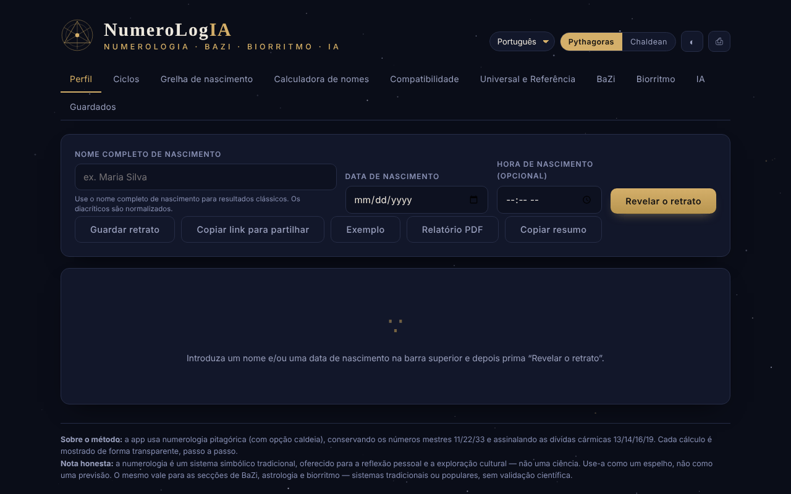

# NumeroLogIA

[English](README.md) · [Română](README.ro.md) · [Français](README.fr.md) · [Italiano](README.it.md) · [Español](README.es.md) · **Português** · [Deutsch](README.de.md) · [Magyar](README.hu.md)

**Versão:** 1.2.0 · **Última atualização:** 2026-10-19

Idiomas da interface: **Română, English, Français, Italiano, Español, Português (PT), Català, Deutsch, Magyar**

Numerologia pitagórica e caldaica, com análise de ciclos, compatibilidade e um oráculo de IA opcional que funciona no seu modelo local.

**Aplicação online:** https://chiuta.github.io/NumeroLogIA/

## O que é

O NumeroLogIA calcula um «retrato» numerológico a partir do nome completo de nascimento, da data de nascimento e, opcionalmente, da hora de nascimento. A aplicação usa a numerologia pitagórica (com opção caldaica), mantém os números mestres 11/22/33 e assinala as dívidas cármicas 13/14/16/19; os cálculos são apresentados passo a passo. A aplicação esclarece explicitamente que a numerologia é um sistema simbólico tradicional, oferecido para reflexão pessoal e exploração cultural, e não uma ciência.

## Funcionalidades

- Interface em 9 línguas: inglês, romeno, italiano, espanhol, francês, português, catalão, alemão, húngaro.
- Comutador de sistema **Pitágoras / Caldeu**; tema claro/escuro (botão ◐); **⎙** para imprimir / guardar em PDF.
- Separadores: **Perfil**, **Ciclos**, **Grelha de nascimento**, **Calculadora de nomes**, **Compatibilidade**, **Universal e Referência**, **BaZi**, **Biorritmo**, **IA**, **Guardados**.
- Botões no Perfil: **Revelar o retrato**, **Guardar o retrato**, **Copiar ligação partilhável**, **Exemplo**, **Relatório PDF**.
- Calculadora de valor numérico para qualquer nome ou palavra, discriminada letra a letra (vogais e consoantes), nos dois sistemas, e comparação de dois nomes (nomes artísticos, nomes de casada, pseudónimos).
- Compatibilidade entre duas pessoas (Caminho de Vida, Expressão, Desejo da Alma).
- Os números universais do dia e uma referência completa dos números.
- **Retratos guardados** no navegador, com **exportação / importação JSON** (cópia de segurança; na importação validam-se o nome, a data e a hora, eliminam-se os duplicados, máximo de 50 entradas, ficheiro com menos de 1 MB).
- **Copiar o resumo** (Perfil): os números principais em texto simples, com a nota de que a numerologia não tem validação científica; uma data introduzida inválida produz agora uma mensagem.
- **Oráculo de IA** (opcional): síntese do retrato, orientação para hoje, interpretação de compatibilidade e perguntas livres, enviadas para um modelo de linguagem num endereço que define você mesmo (por predefinição, Ollama local). Pode listar os modelos instalados e transferir modelos através do Ollama.

## Manual de utilização

1. Escolha a língua na lista de línguas e o sistema (Pitágoras ou Caldeu).
2. Em «Perfil», introduza o nome completo de nascimento (os sinais diacríticos são normalizados), a data de nascimento e, se quiser, a hora; prima **Revelar o retrato** (Enter nos campos faz o mesmo). **Exemplo** preenche dados de demonstração.
3. Percorra os separadores Ciclos, Grelha de nascimento, BaZi e Biorritmo para o resto da análise.
4. Para uma palavra qualquer, use «Calculadora de nomes»; para duas pessoas, «Compatibilidade».
5. **Guardar o retrato** guarda-o no separador «Guardados»; **Copiar ligação partilhável** coloca na ligação o nome, a data, a hora, a língua e o sistema.
6. **Relatório PDF** ou **⎙** abrem a caixa de impressão do navegador, a partir da qual pode guardar um PDF.
7. Para o separador de IA: instale o Ollama (ou outro servidor compatível com OpenAI), inicie um modelo, abra «Definições», verifique o endereço (por predefinição `http://localhost:11434/v1`) e o modelo, prima guardar / testar e escolha uma ação. Se a página for servida a partir de um site, a aplicação indica que se inicie o Ollama com `OLLAMA_ORIGINS=*` para permitir a ligação a partir do navegador.

## Aviso

Conteúdo informativo/de entretenimento, sem validação científica: a numerologia, o BaZi, a astrologia e o biorritmo são sistemas simbólicos tradicionais ou populares, não ciências, e não oferecem previsões nem aconselhamento médico, financeiro ou jurídico. A aplicação apresenta uma «Nota honesta» no rodapé; os textos gerados por IA podem estar errados ou ser inventados.

## Privacidade e rede

- **Armazenamento local (localStorage):** `numerologie_saved_v1` (os retratos guardados), chaves `num_pref_*` (língua, sistema, tema) e `num_ai_*` (o endereço, o modelo e, se a introduzir, a chave API do oráculo de IA: por predefinição é mantida apenas em `sessionStorage` (até fechar o separador) e chega sem cifra ao `localStorage` somente se assinalar «Memorizar a chave entre sessões»; a aplicação apresenta agora um aviso visível por baixo do campo «Chave API» nas Definições de IA, nas 7 línguas).
- **Rede:** os cálculos numerológicos não fazem pedidos. Os únicos pedidos possíveis são os do separador de IA, apenas quando prime uma ação de IA (ou a listagem/transferência de modelos), para o endereço que configurou, por predefinição `http://localhost:11434` (Ollama no seu próprio computador). Se definir um endereço remoto, os seus nomes, dados e perguntas chegam a esse servidor. A aplicação não inclui chaves, análise de dados nem telemetria e não carrega recursos de terceiros; uma política CSP (`default-src 'none'`, `connect-src http: https:`) impede a página de qualquer outro carregamento.
- A ligação partilhável contém, na parte após `#`, o nome e a data introduzidos (o hash é atualizado a cada cálculo, pelo que aparece também na barra de endereços/histórico do navegador, mas não é enviado a nenhum servidor); a mensagem de confirmação da cópia diz agora explicitamente que a ligação contém o nome e a data de nascimento; partilhe-a conscientemente.

## Execução local / offline

Transfira `index.html` e abra-o num navegador; a numerologia funciona sem internet. O oráculo de IA precisa de um servidor de modelos local (por exemplo, Ollama) ou de um endereço à sua escolha.

## Histórico / Changelog

### 1.1.0 — 2026-10-14
- Cópia de segurança e etiquetagem de dados (fff-kit).

### 12 de outubro de 2026 (v1.0.0)
- 1.0.0 — 2026-10-12: a versão e a data da última atualização são apresentadas na aplicação

### 11 de outubro de 2026 (segunda entrada)
- Segurança: a chave API do oráculo de IA é mantida por predefinição apenas durante a sessão; o armazenamento em `localStorage` é uma opção explícita («Memorizar a chave entre sessões», 7 línguas), e ao guardar uma chave antiga em `localStorage` é movida para a sessão se a opção não estiver assinalada. Testado no navegador.

### 11 de outubro de 2026
- Acessibilidade: conteúdo envolvido em <main>, canvas decorativo oculto dos leitores de ecrã, etiquetas ligadas aos campos (axe: 0 violações).
- Os dados de «hoje» (números universais, BaZi) são calculados dinamicamente a partir da data atual; não há datas fixas desatualizadas. Os atributos `on*` em linha (22) foram substituídos por um despachante delegado (`data-click` / `data-change` / `data-input` / `data-keydown`, lista de permissões de funções, argumentos JSON) e a CSP usa um hash para o script, sem `'unsafe-inline'` para scripts (mantém-se para estilos; `connect-src http: https:` mantém-se para o endereço configurável do modelo de IA).
- Novo: exportação/importação JSON dos retratos guardados, «Copiar o resumo», mensagem para data inválida (nas 7 línguas). Captura de ecrã atualizada.

## Licença

MIT — veja o ficheiro `LICENSE`. © 2026 Alexandru-Ionuț Chiuță (Alexio). As eventuais bibliotecas de terceiros incluídas no ficheiro mantêm as suas próprias licenças.

Licença: MIT (veja o ficheiro LICENSE). Contacto: alexio@trom.tf

A mesma declaração aparece no cabeçalho HTML e no rodapé da aplicação (RO + EN). O texto da licença encontra-se no ficheiro LICENSE.

## Auditoria

Auditoria: 2026-10-10 — verificado com Playwright e axe-core (todos os separadores, ambos os temas); verificado no código: um único `fetch` (separador de IA, mediante ação, para o endereço configurado); o nome proveniente da ligação `#n=` e dos campos, testado com ``, não é executado (escapado). Corrigidos: etiquetas em falta nos campos de data/hora, contraste no tema claro, nome acessível do cursor do biorritmo.

## Autor

Alexio — Alexandru-Ionuț Chiuță. Contacto: alexio@trom.tf

## Resumo
O NumeroLogIA é uma ferramenta de numerologia de ficheiro único (sistemas pitagórico e caldaico, números mestres, ciclos, grelha de nascimento, calculadora de nomes, compatibilidade, BaZi, biorritmo) em 9 línguas, com retratos guardados em localStorage. Um separador de IA opcional comunica apenas com um ponto de acesso que você configura (por predefinição: Ollama local em localhost:11434); com um ponto de acesso remoto, os seus dados seriam enviados para lá. Sem telemetria nem recursos de terceiros. Licença: MIT (veja o ficheiro LICENSE) (contacto: alexio@trom.tf).

Ronda 3 (2026-10-11): acrescentada uma declaração de licença explícita (antes não declarada) (cabeçalho, rodapé, README); acrescentada a CSP; o tema esotérico e o armazenamento da chave API continuam a ser decisões do autor.
