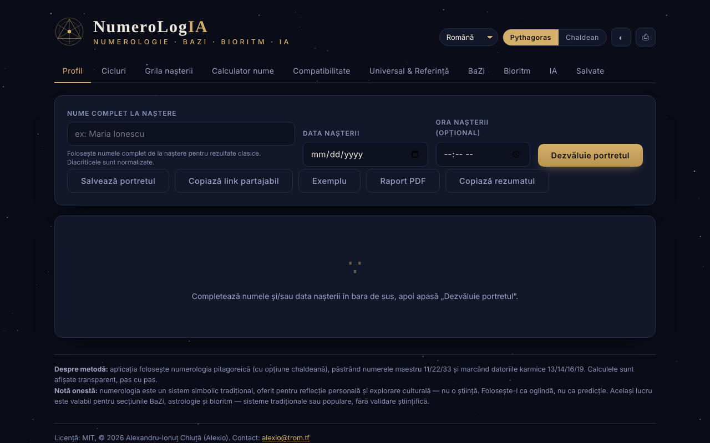

# NumeroLogIA

[English](README.md) · **Română** · [Français](README.fr.md) · [Italiano](README.it.md) · [Español](README.es.md) · [Português](README.pt.md) · [Deutsch](README.de.md) · [Magyar](README.hu.md)

**Versiune:** 2.0.1 · **Ultima actualizare:** 2026-10-27

**Stare:** stabil; explică unealtă vs. curs și trimite la Numerologie · **Offline:** complet (fără cereri de rețea)

Limbile interfeței: **Română, English, Français, Italiano, Español, Português (PT), Català, Deutsch, Magyar**

Numerologie pitagoreică și chaldeană, cu analiză a ciclurilor, compatibilitate și un oracol IA opțional care rulează pe modelul tău local.

**Live:** https://chiuta.github.io/NumeroLogIA/

## Ce este

NumeroLogIA calculează un „portret” numerologic pornind de la numele complet de la naștere, data nașterii și, opțional, ora nașterii. Aplicația folosește numerologia pitagoreică (cu opțiune chaldeană), păstrează numerele maestru 11/22/33 și marchează datoriile karmice 13/14/16/19; calculele sunt afișate pas cu pas. Aplicația precizează explicit că numerologia este un sistem simbolic tradițional, oferit pentru reflecție personală și explorare culturală, nu o știință.

## Funcții

- Interfață în 9 limbi: engleză, română, italiană, spaniolă, franceză, portugheză, catalană, germană, maghiară.
- Comutator de sistem **Pythagoras / Chaldean**; temă deschisă/închisă (butonul ◐); **⎙** pentru tipărire / salvare PDF.
- File: **Profil**, **Cicluri**, **Grila nașterii**, **Calculator nume**, **Compatibilitate**, **Universal & Referință**, **BaZi**, **Bioritm**, **IA**, **Salvate**.
- Butoane în Profil: **Dezvăluie portretul**, **Salvează portretul**, **Copiază link partajabil**, **Exemplu**, **Raport PDF**.
- Calculator de valoare numerică pentru orice nume sau cuvânt, defalcat literă cu literă (vocale și consoane), în ambele sisteme, și compararea a două nume (nume de scenă, după căsătorie, pseudonime).
- Compatibilitate între două persoane (Drumul Vieții, Expresia, Dorința Sufletului).
- Numerele universale ale zilei și o referință completă a numerelor.
- **Portrete salvate** în browser, cu **export / import JSON** (copie de siguranță; la import se validează numele, data și ora, se elimină duplicatele, maximum 50 de intrări, fișier sub 1 MB).
- **Copiază rezumatul** (Profil): numerele principale ca text simplu, cu nota că numerologia nu are validare științifică; o dată introdusă invalidă produce acum un mesaj.
- **Oracol IA** (opțional): sinteză de portret, ghidaj pentru azi, interpretare de compatibilitate și întrebări libere, trimise către un model lingvistic la o adresă pe care o setezi tu (implicit Ollama local). Poate lista modele instalate și descărca modele prin Ollama.

## Manual de utilizare

1. Alege limba din lista de limbi și sistemul (Pythagoras sau Chaldean).
2. În „Profil”, introdu numele complet de la naștere (diacriticele sunt normalizate), data nașterii și, dacă vrei, ora; apasă **Dezvăluie portretul** (Enter în câmpuri face același lucru). **Exemplu** completează date demonstrative.
3. Parcurge filele Cicluri, Grila nașterii, BaZi și Bioritm pentru restul analizei.
4. Pentru un cuvânt oarecare, folosește „Calculator nume”; pentru două persoane, „Compatibilitate”.
5. **Salvează portretul** îl păstrează în fila „Salvate”; **Copiază link partajabil** pune în link numele, data, ora, limba și sistemul.
6. **Raport PDF** sau **⎙** deschid dialogul de tipărire al browserului, de unde poți salva PDF.
7. Pentru fila IA: instalează Ollama (sau alt server compatibil OpenAI), pornește un model, deschide „Setări”, verifică adresa (implicit `http://localhost:11434/v1`) și modelul, apasă salvare / test, apoi alege o acțiune. Dacă pagina este servită de pe un site, aplicația indică pornirea Ollama cu `OLLAMA_ORIGINS=*` pentru a permite conexiunea din browser.

## Avertisment

Conținut informativ/de divertisment, fără validare științifică: numerologia, BaZi, astrologia și bioritmul sunt sisteme simbolice tradiționale sau populare, nu științe, și nu oferă predicții sau sfaturi medicale, financiare ori juridice. Aplicația afișează o „Notă onestă" în subsol; textele generate de IA pot fi greșite sau inventate.

## Confidențialitate și rețea

- **Stocare locală (localStorage):** `numerologia.saved_v1` (portretele salvate), chei `numerologia.pref.*` (limbă, sistem, temă) și `numerologia.ai.*` (adresa, modelul și, dacă o introduci, cheia API a oracolului IA: implicit se păstrează doar în `sessionStorage` (până la închiderea filei) și ajunge necriptată în `localStorage` doar dacă bifezi „Reține cheia între sesiuni”; aplicația afișează acum un avertisment vizibil sub câmpul „Cheie API” din Setările IA, în toate cele 7 limbi).
- **Rețea:** calculele numerologice nu fac cereri. Singurele cereri posibile sunt cele din fila IA, doar când apeși o acțiune IA (sau listare/descărcare de modele), către adresa configurată de tine, implicit `http://localhost:11434` (Ollama pe calculatorul tău). Dacă setezi o adresă la distanță, numele, datele și întrebările tale ajung la acel server. Aplicația nu include chei, analytics sau telemetrie și nu încarcă resurse de la terți; o politică CSP (`default-src 'none'`, `connect-src http: https:`) limitează paginii orice altă încărcare.
- Linkul partajabil conține în partea de după `#` numele și data introduse (hash-ul se actualizează la fiecare calcul, deci apare și în bara de adrese/istoricul browserului, dar nu este trimis niciunui server); mesajul de confirmare la copiere spune acum explicit că linkul conține numele și data nașterii; partajează-l conștient.

## Rulare locală / offline

Descarcă `index.html` și deschide-l în browser; numerologia funcționează fără internet. Oracolul IA are nevoie de un server de modele local (de exemplu Ollama) sau de o adresă la alegerea ta.

## NumeroLogIA vs. Numerologie: unealtă vs. curs (2026-10-27)

O notă scurtă în partea de jos a aplicației (9 limbi) explică diferența și trimite la aplicația-soră: **NumeroLogIA este o unealtă** (portret numeric, cicluri, compatibilitate, BaZi), iar **[Numerologie](https://chiuta.github.io/Numerologie/) este un curs** (istoric, sistemele pitagoreic/caldeean/cabalistic, exerciții, test). Sunt aplicații separate, complementare: **nu au fost fuzionate** și nu s-a șters conținut.

## Istoric / Changelog

### 2.0.0 — 2026-10-26

Fila nouă „Metoda": explicator al calculului pas cu pas (reducerea datei, valoarea fiecărei litere, subtotaluri pe cuvinte, numere maestru, comparație pitagoreic/caldeean), cu copiere și export .txt. Arată că e aritmetică, nu predicție. Test: `tests/metoda.test.mjs`.

### 1.2.8 — 2026-10-23

Audit: accesibilitate. Titlurile de secțiune au nivel de titlu consecvent (aria-level, fără schimbare vizuală), iar linia „tulpinilor ascunse” din stâlpii BaZi respectă contrastul (11 px, fără opacitate redusă). axe: 0 încălcări în cele zece file la 360 px, întunecat și luminos.

### 1.2.7 — 2026-10-23

- Stocare: cheile poartă acum prefixul aplicației (`numerologia.saved_v1`, `numerologia.pref.*`, `numerologia.ai.*`); datele existente se mută automat la pornire din cheile vechi (`numerologie_saved_v1`, `num_pref_*`, `num_ai_*`), iar copiile `.fff.json` mai vechi se importă în continuare (fff-kit 1.2.0).

### 1.2.5 — 2026-10-22

fff-kit 1.1.4: ținte tactile și text minim.

### 1.2.4 — 2026-10-22
- fff-kit 1.1.2: PBKDF2 600 000 iterații, protecție anti-clickjacking

### 1.2.3 — 2026-10-22
- Înainte ca oracolul IA să trimită date personale (data nașterii, numele), adresa modelului este validată (doar http/https), iar pentru orice server care nu e pe acest dispozitiv sau în rețeaua locală se cere acordul explicit (reținut per gazdă, doar în sesiune); confirmarea ștergerii ca dialog propriu; textul indiciilor la 12 px.

### 1.2.2 — 2026-10-22
- Nota de licență/contact din subsol este tradusă în toate limbile interfeței.

### 1.1.0 — 2026-10-14
- Copie de rezervă și etichetare date (fff-kit).

### 12 octombrie 2026 (v1.0.0)
- 1.0.0 — 2026-10-12: versiunea și data ultimei actualizări sunt afișate în aplicație

### 11 octombrie 2026 (a doua intrare)
- Securitate: cheia API a oracolului IA se păstrează implicit doar în sesiune; stocarea în `localStorage` este opțiune explicită („Reține cheia între sesiuni”, 7 limbi), iar la salvare o cheie veche din `localStorage` este mutată în sesiune dacă opțiunea nu e bifată. Testat în browser.

### 11 octombrie 2026
- Accesibilitate: conținutul încadrat în <main>, canvas-ul decorativ ascuns de cititoarele de ecran, etichete legate de câmpuri (axe: 0 violări).
- Datele „azi” (numere universale, BaZi) se calculează dinamic din data curentă; nu există date fixe perimate. Atributele `on*` inline (22) au fost înlocuite cu un dispatcher delegat (`data-click` / `data-change` / `data-input` / `data-keydown`, listă albă de funcții, argumente JSON) iar CSP folosește hash pentru script, fără `'unsafe-inline'` la scripturi (rămâne la stiluri; `connect-src http: https:` rămâne pentru adresa configurabilă a modelului IA).
- Nou: export/import JSON al portretelor salvate, „Copiază rezumatul”, mesaj pentru dată invalidă (în cele 7 limbi). Captura de ecran actualizată.

## Licență

MIT — vezi fișierul `LICENSE`. © 2026 Alexandru-Ionuț Chiuță (Alexio). Eventualele biblioteci terțe incluse în fișier își păstrează licențele proprii.

License: MIT (see the LICENSE file). Contact: alexio@trom.tf

Aceeași declarație apare în antetul HTML și în subsolul aplicației (RO + EN). Textul licenței se află în fișierul LICENSE.

## Audit

Audit: 2026-10-10 — verificat cu Playwright și axe-core (toate filele, ambele teme); verificat în cod: un singur `fetch` (fila IA, la acțiune, către adresa configurată); numele din linkul `#n=` și din câmpuri, testat cu ``, nu se execută (escape). Corectate: etichete lipsă la câmpurile de dată/oră, contrast în tema luminoasă, nume accesibil la glisorul de bioritm.

## Autor

Alexio — Alexandru-Ionuț Chiuță. Contact: alexio@trom.tf

## Rezumat

NumeroLogIA este un instrument de numerologie într-un singur fișier (sisteme pitagoreic și caldeean, numere-maestru, cicluri, grila nașterii, calculator de nume, compatibilitate, BaZi, bioritm) în 9 limbi, cu portrete salvate în localStorage. O filă AI opțională comunică doar cu un punct final configurat de tine (implicit: Ollama local la localhost:11434); cu un punct final la distanță, datele introduse ar fi trimise acolo. Fără telemetrie sau resurse terțe. Licență: MIT (vezi fișierul LICENSE) (contact: alexio@trom.tf).

Runda 3 (2026-10-11): declarație explicită de licență nedeclarată (antet, subsol, README); adăugat CSP; tema esoterică și stocarea cheii API rămân decizii ale autorului.
